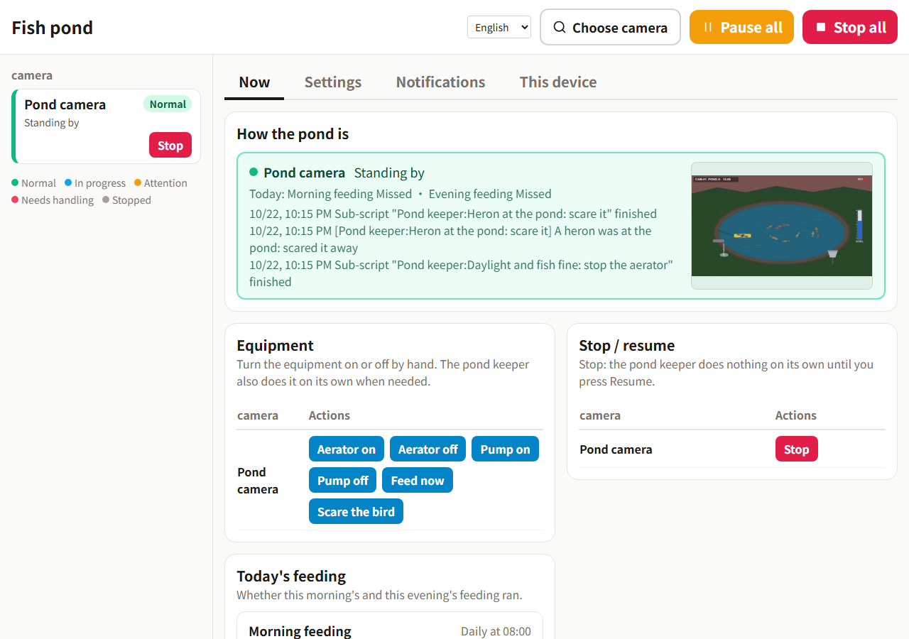

# Inspector demo: a fish pond

A simulated fish pond with a camera, to try [Inspector](https://github.com/wrbyhaquc/inspector) without a real farm.
It runs on your own computer; the "camera" is a picture the simulator draws, and the "equipment" (aerator, pump,
feeder, bird scarer) are switches Inspector can turn through an HTTP output - the way it would drive real devices.

English · [繁體中文](README.zh-TW.md)


*Nobody touched anything in this clip: Inspector watched the camera picture and ran the equipment through the pack below.*

## What happens in the pond

Time runs fast (by default one day takes 6 minutes).

| What you see | What is going on | What should be done |
|---|---|---|
| Fish at the surface, with rings around them | Oxygen in the water is low (it falls every night) | Turn the aerator on; left alone, fish die before dawn |
| Foam and spray around the yellow paddle wheel | The aerator is running | Turn it off once the oxygen is back, by day |
| The blue water level in the tube on the right goes down | Evaporation; rain brings it up | Run the pump when it is low |
| A white heron at the edge | It takes a fish now and then | Scare it away |
| Pellets flying from the grey feeder | Feeding | Feed on a schedule |

## Run it

Needs Python 3.10+ and Pillow (`pip install pillow`; Inspector already has it).

```bash
python sim/server.py            # http://127.0.0.1:8800/
```

| Address | |
|---|---|
| `http://127.0.0.1:8800/` | The control room: the camera picture, the equipment switches, demo buttons (night now, heron now, rain now, speed) |
| `http://127.0.0.1:8800/video.mjpg` | The camera as an MJPEG stream: in Inspector, "Sources › + Add source › Stream › HTTP" |
| `http://127.0.0.1:8800/snapshot.jpg` | One picture |
| `POST http://127.0.0.1:8800/api/command` | `{"command": "aerator_on"}` - also `aerator_off`, `pump_on`, `pump_off`, `feed`, `scare`. Exactly what an Inspector HTTP output sends |
| `http://127.0.0.1:8800/api/state` | The simulator's own numbers, for checking: Inspector itself only judges from the picture |

Options: `--port`, `--fps` (pictures per second, default 5), `--day-minutes` (real minutes per simulated day),
`--seed` (the same events every run), `--host` (default 127.0.0.1: only this computer).

## Try it in 10 minutes

You need [Inspector](https://github.com/wrbyhaquc/inspector) installed (the Runtime is enough: no PyTorch, no model to train) and this repository.

1. **Start the pond.** `python sim/server.py`, then open http://127.0.0.1:8800/ - the control room. Leave it running.
2. **Start Inspector.** `start.bat` (or `python -m server`) in the Inspector folder; it opens http://127.0.0.1:8765.
3. **Install the pack.** **Packs › Install or upgrade**, choose `pack/releases/fish-pond-1.0.1.zip`
   (`fish-pond-zh-1.0.1.zip` for the Chinese one) and let it become the running pack. Restart Inspector when it asks
   (the button on that page, or close it and start it again). From a command line instead:
   `python -m project.pack install pack/releases/fish-pond-1.0.1.zip --activate` in the Inspector folder, then start it.
4. **Check the camera.** **Sources** shows *Pond camera*: the pack brings its address
   (`http://127.0.0.1:8800/video.mjpg`), so nothing has to be typed. Running the simulator on another computer or port?
   Change the address there.
5. **Run.** **Run › Start**. The pack has no trained model; every state is judged by screen rules
   (colours, a level bar), so it works straight away.
6. **Open the operation panel** (**Operation panel ↗**, also fine on a phone) and make things happen on the
   simulator's page:
   - **Night now** - the oxygen falls, fish come up gasping, and the aerator goes on by itself.
   - **Heron now** - the heron is scared away within a few seconds.
   - **Water low** - the pump runs until the level is back (75 % by default).
   - **Day now** - once the fish are fine by daylight, the aerator goes off again.

   Feeding runs at 08:00 and 17:00 by your computer's clock (schedules use real time, not the pond's); the panel's **Settings** change the times, the pump levels and whether
   each feeding happens. What you change there stays on your computer and survives installing a newer pack.



## What is in the pack

| | |
|---|---|
| States | `fish_surfacing`, `aerator_running`, `water_level`, `heron`, `daylight` - colour and level-bar rules on the camera picture (`pack/states.json`) |
| Output | `pond`: HTTP `POST` to the simulator's `/api/command` |
| Main script | *Pond keeper*: fish surfacing → aerator on (urgent); heron → scare it; water below the setting → pump on, above → off; daylight and fish fine → aerator off |
| Sub-scripts | aerator on / off, pump on / off, feed, scare the bird |
| Schedules | morning and evening feeding |
| Operation panel | status and log, equipment buttons, stop / resume, today's feeding, settings, notifications |

`pack/build.py` makes the pack through Inspector's own API (`--lang en` or `zh-TW`), and `python -m project.pack export` (in the Inspector folder)
turns it into the zip in `pack/releases/`. `tools/check_states.py` checks the state rules against pictures of every
situation the simulator can draw.

## License

Apache-2.0.
