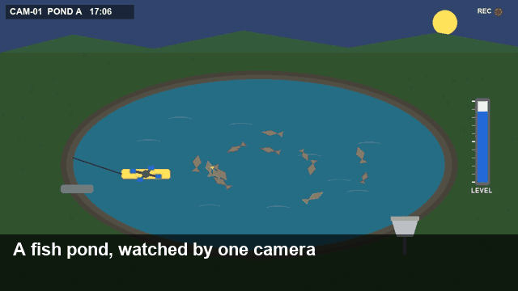
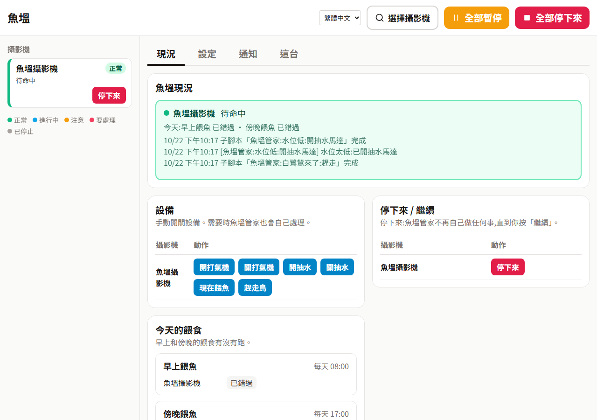

# Inspector 示範:魚塭

一個附攝影機的模擬魚塭,不用真的魚塭就能試用 [Inspector](https://github.com/wrbyhaquc/inspector)。
它在你自己的電腦上執行;「攝影機」是模擬器畫出來的畫面,「設備」(打氣機、抽水馬達、餵料機、驅鳥器)是 Inspector 可以透過 HTTP 輸出切換的開關,就像控制真的設備一樣。

[English](README.md) · 繁體中文



*這段影片裡沒有人動手:Inspector 看攝影機畫面,透過下面的方案包操作設備。*

## 魚塭裡會發生什麼

時間跑得比較快(預設一天 6 分鐘)。

| 畫面上看到的 | 實際上是 | 該怎麼處理 |
|---|---|---|
| 魚浮到水面、周圍一圈圈漣漪 | 水裡的溶氧不夠(每天晚上都會下降) | 開打氣機;沒人處理的話,天亮前會死魚 |
| 黃色水車周圍冒泡、水花 | 打氣機在運轉 | 白天溶氧回來後再關掉 |
| 右邊水位管裡的藍色水位往下降 | 蒸發;下雨會漲回來 | 水位太低就開抽水馬達 |
| 岸邊出現白鷺鷥 | 牠會不時叼走一條魚 | 把牠趕走 |
| 灰色餵料機噴出飼料 | 正在餵食 | 用排程定時餵 |

## 執行

需要 Python 3.10 以上與 Pillow(`pip install pillow`;裝了 Inspector 就已經有)。

```bash
python sim/server.py            # http://127.0.0.1:8800/
```

| 位址 | |
|---|---|
| `http://127.0.0.1:8800/` | 監控室:攝影機畫面、設備開關、示範用按鈕(立刻天黑、立刻來鳥、立刻下雨、時間速度) |
| `http://127.0.0.1:8800/video.mjpg` | 攝影機的 MJPEG 串流:在 Inspector「來源 › + 加入來源 › 影像串流 › HTTP」 |
| `http://127.0.0.1:8800/snapshot.jpg` | 一張畫面 |
| `POST http://127.0.0.1:8800/api/command` | `{"command": "aerator_on"}`;另有 `aerator_off`、`pump_on`、`pump_off`、`feed`、`scare`。格式和 Inspector 的 HTTP 輸出送出的完全相同 |
| `http://127.0.0.1:8800/api/state` | 模擬器自己的數字,只給你核對用:Inspector 只看畫面判斷 |

參數:`--port`、`--fps`(每秒幾張,預設 5)、`--day-minutes`(模擬一天是真實幾分鐘)、`--seed`(每次發生同樣的事件)、`--host`(預設 127.0.0.1:只有這台電腦連得到)。

## 10 分鐘試用

需要先裝好 [Inspector](https://github.com/wrbyhaquc/inspector)(Runtime 版就夠:不用 PyTorch,也不用訓練模型),再加上這個 repo。

1. **啟動魚塭。** `python sim/server.py`,打開 http://127.0.0.1:8800/ 監控室。讓它一直開著。
2. **啟動 Inspector。** 在 Inspector 資料夾執行 `start.bat`(或 `python -m server`),會打開 http://127.0.0.1:8765。
3. **安裝方案包。** **方案包 › 安裝或升級**,選 `pack/releases/fish-pond-zh-1.0.0.zip`(英文版是 `fish-pond-1.0.0.zip`),
   並設成執行中的方案包。依提示重新啟動 Inspector(用那一頁的按鈕,或關掉再開)。
   也可以用指令:在 Inspector 資料夾執行 `python -m project.pack install pack/releases/fish-pond-zh-1.0.0.zip --activate`,再啟動。
4. **確認攝影機。** **來源** 頁會有「魚塭攝影機」:方案包已經帶好位址(`http://127.0.0.1:8800/video.mjpg`),不用自己輸入。
   模擬器在別台電腦或別的連接埠?在那裡改位址就好。
5. **開始執行。** **執行 › 開始**。這個方案包沒有訓練好的模型,每個狀態都用畫面規則(顏色、水位條)判斷,所以馬上就能用。
6. **打開操作面板**(**操作面板(給使用者) ↗**,手機也能用),然後在模擬器頁面上製造狀況:
   - **Night now(立刻天黑)**:溶氧下降、魚浮頭,打氣機會自己打開。
   - **Heron now(立刻來鳥)**:幾秒內白鷺鷥就被趕走。
   - **Water low(水位降低)**:抽水馬達開始抽水,直到水位回來(預設 75%)。
   - **Day now(立刻天亮)**:白天魚沒事了,打氣機會再關掉。

   餵食在電腦時間 08:00 和 17:00 自動進行(排程用的是真實時間,不是魚塭的時間);操作面板的 **設定** 可以改時間、抽水的水位、每一餐要不要餵。
   你在那裡改的值存在你自己的電腦上,安裝新版方案包也會保留。



## 方案包裡有什麼

| | |
|---|---|
| 狀態 | `fish_surfacing`、`aerator_running`、`water_level`、`heron`、`daylight`:攝影機畫面上的顏色與水位條規則(`pack/states.json`) |
| 輸出 | `pond`:以 HTTP `POST` 送到模擬器的 `/api/command` |
| 主腳本 | 「魚塭管家」:魚浮頭 → 開打氣機(緊急);白鷺鷥 → 趕走;水位低於設定 → 開抽水,高於 → 關;白天且魚沒事 → 關打氣機 |
| 子腳本 | 打氣機開 / 關、抽水開 / 關、餵食、趕鳥 |
| 排程 | 早上、傍晚各餵一次 |
| 操作面板 | 狀態與日誌、設備按鈕、停止 / 繼續、今天的餵食、設定、通知 |

`pack/build.py` 透過 Inspector 自己的 API 做出這個方案包(`--lang en` 或 `zh-TW`),再用 `python -m project.pack export`(在 Inspector 資料夾)變成 `pack/releases/` 裡的 zip。
`tools/check_states.py` 用模擬器能畫出的每一種狀況檢查狀態規則。

## 授權

Apache-2.0。
